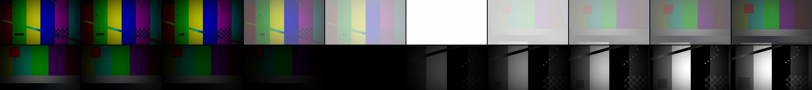

# beatcut ✂️🥁

[](https://github.com/hadidammam505-web/beatcut/actions/workflows/ci.yml)


**Copy a reference edit's cuts and rhythm, then render your own footage on the beat. All from the command line.**

You found a gym or montage edit you love. beatcut measures where every cut lands and how they line up with the music. It drafts an edit plan from your clips with the same shot lengths, then renders it with ffmpeg. You get push-ins, punch zooms, white flashes and a dark cinematic grade, and every shot comes out frame-exact.

**[العربية](#بالعربي)** · English below

```text
reference.mp4 ──► beatcut analyze ──► cuts + tempo + onsets
                                          │
your clips/ ──────► beatcut scaffold ◄────┘
                          │
                     plan.json  ◄── you pick the real moments (edit "start")
                          │
                    beatcut check  ──► how far each cut is from the beat
                          │
                    beatcut build  ──► edit.mp4 (+ contact sheet)
```

## Why

Timeline editors make you drag every cut by hand. beatcut treats an edit as **data**: a JSON list of shots. That means:

- **Exact.** Each shot has exactly the frames you planned. Even one-frame flashes survive, and nothing drifts.
- **Repeatable.** Change one shot and only that shot re-renders, because segments are cached.
- **Measurable.** `beatcut check` tells you, in milliseconds, how far each cut is from the music.
- **Light.** The only dependencies are numpy and ffmpeg. No OpenCV, no librosa, no GPU.

It grew out of the scripts behind [six real gym edits](https://github.com/hadidammam505-web/video-edit-pipeline).

## Install

You need [ffmpeg](https://ffmpeg.org/download.html) on your `PATH` (or set `BEATCUT_FFMPEG` / `BEATCUT_FFPROBE`).

```bash
pip install git+https://github.com/hadidammam505-web/beatcut.git
beatcut --version
```

## Quick start

```bash
# 1. Measure the reference: cuts, tempo, onsets, and how tight its cuts are to the music
beatcut analyze reference.mp4 -o ref.json
#   prints the tempo, the number of cuts, and the median / worst cut-to-onset offset

# Letterboxed reference? Compare only the picture area, because the bars hide the cuts
beatcut analyze reference.mp4 --crop 0 0.3 1 0.7 -o ref.json

# 2. Draft a plan: one shot per reference shot, same lengths, your clips in turn
beatcut scaffold ref.json clips/ --song song.wav -o plan.json

# 3. Open plan.json and set each shot's "start" to a real moment (a full, hard rep).
#    Add crops, motion and transitions. Then check it:
beatcut check plan.json
#   prints shots, frames, length and size, lists missing files,
#   and how far each cut is from the song's onsets

# 4. Render a fast preview, then the real thing
beatcut build plan.json --preview
beatcut build plan.json --sheet      # also writes a contact sheet to check by eye
```

## The plan

```json
{
  "output": "out/gym-edit.mp4",
  "size": [1920, 1080],
  "fps": 30,
  "grade": "dark-vivid",
  "song": { "path": "song.wav", "start": 12.4, "gain_db": -2, "fade_out": 0.6 },
  "shots": [
    { "src": "clips/leg-extension.mov", "start": 22.7, "duration": 0.70,
      "crop": { "size": 0.8, "x": 0.05, "y": 0.08 }, "motion": "push" },
    { "src": "clips/leg-extension.mov", "start": 34.0, "duration": 0.90,
      "crop": { "size": 0.28, "x": 0.39, "y": 0.22 }, "motion": "punch", "transition": "flash" },
    { "src": "clips/chest.mov", "start": 20.0, "duration": 1.72, "grade": "mono" }
  ]
}
```

See [`examples/plan.json`](examples/plan.json) for a full nine-shot edit.

| Shot field | Values |
|---|---|
| `src`, `start`, `duration` | Source clip, in point and length in seconds. Paths are relative to the plan file. |
| `crop` | `size` (fraction of the frame) and `x`, `y` (top-left corner, also fractions). Repeat a moment with tighter crops for the classic "closer, closer, closer" build. |
| `motion` | `none`, `push` (slow push-in), `pull` (starts close, eases out to reveal the full rep), `punch` (fast 0.35 s punch-in). |
| `transition` | What happens at the end of the shot. `cut`, `flash` (3 frames to white, then 5 frames in from white on the next shot), or `fade` (dip to black). |
| `grade` | Per-shot override of the plan's grade. |
| `speed` | `0.5` for slow motion, `2` for double speed. |

### Grades

```bash
beatcut grades
```

| Grade | Look |
|---|---|
| `dark` | Muted, dark and cool, with crushed highlights, vignette and grain |
| `dark-vivid` | The same dark curve with stronger colour |
| `cinematic` | Slightly lifted dark look that keeps the reds |
| `mono` | High-contrast black and white with grain |
| `warm` | Gentle warm shift for daylight and lifestyle shots |
| `custom:<filters>` | Any ffmpeg filter chain |

### Transitions, frame by frame



*Top row: a `flash`, with three frames out to white and five frames in from white. Bottom row: a `fade` to black, into a `mono` shot with a `pull` zoom. Rendered from test patterns in the test suite.*

## Commands

| Command | What it does |
|---|---|
| `beatcut analyze REF` | Cuts (pixel + histogram difference against the local median, so camera motion isn't a cut), tempo, beat grid, onsets, and the offset of each cut from the nearest onset. |
| `beatcut beats SONG` | Tempo, beat grid and onsets of a song. |
| `beatcut align CUTS SONG` | Per-cut offset from the nearest onset or beat. `CUTS` can be a plan, an analysis or a list like `"0.5 1.2 2.0"`. |
| `beatcut scaffold REF.json CLIPS/` | A first plan with the reference's shot lengths. |
| `beatcut check PLAN` | Validates the plan, finds missing files, and measures the cuts against the song. |
| `beatcut build PLAN` | Renders the plan. Use `--preview` for one-third size, `--force` to ignore the cache, `--sheet` for a contact sheet. |
| `beatcut sheet VIDEO` | Contact sheet of any video. |

## How it works

- **Cuts:** ffmpeg decodes the reference to 96×54 grey frames. Each frame scores `0.6 × mean pixel change + 0.4 × histogram change`. A frame counts as a cut only when it scores above a threshold, at least 3× the median of the frames around it, and is a local peak. That rejects whip pans and fast reps.
- **Onsets:** spectral flux on a centred STFT (1024 / 256 at 22.05 kHz), with a running-median floor removed so noise and pads don't trigger. **Tempo** comes from the autocorrelation of that envelope with a mild prior around 120 BPM, and the **beat grid** is set at the phase with the most onset energy. On the test click track it finds 16/16 onsets within 15 ms and no false ones.
- **Render:** each shot becomes a cached segment with exactly its planned frame count. `tpad` holds the last frame if the source runs out. The segments are joined with ffmpeg's concat *filter*, because the concat demuxer with stream copy silently drops one-frame segments.

## Develop

```bash
git clone https://github.com/hadidammam505-web/beatcut.git
cd beatcut
python -m venv .venv && . .venv/bin/activate     # Windows: .venv\Scripts\activate
pip install -e ".[dev]"
pytest -q          # 33 tests; the ffmpeg ones build their own synthetic media
ruff check src tests
```

## Roadmap

- [ ] Body-flash transition: a white silhouette of the next shot's person (needs a person mask)
- [ ] Glitch and whip-slide transitions
- [ ] Words on screen, timed to the song
- [ ] Vertical 9:16 presets and letterbox layout
- [ ] Export the plan to FCPXML for DaVinci Resolve / Final Cut

Ideas and bug reports are welcome in [Issues](https://github.com/hadidammam505-web/beatcut/issues).

---

## بالعربي

**beatcut** أداة سطر أوامر تنسخ إيقاع مونتاج يعجبك وتطبّقه على مقاطعك:

1. **`analyze`**: تقيس كل قطع في المقطع المرجعي، وسرعة الأغنية، وكم يبعد كل قطع عن الضربة.
2. **`scaffold`**: تسوّي لك خطة أولى بنفس أطوال اللقطات من مقاطعك.
3. تختار أنت اللحظات الحقيقية، العدّات الكاملة الثقيلة، وتضيف الزوم والفلاش.
4. **`check`**: تقولك بالملي ثانية إذا قطعاتك على الإيقاع.
5. **`build`**: تطلّع الفيديو بالضبط فريم بفريم، مع لون داكن سينمائي.

كل اللي تحتاجه بايثون و numpy و ffmpeg بس.

## License

MIT
